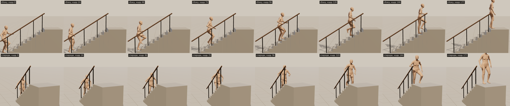
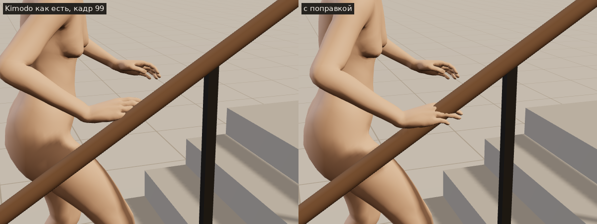
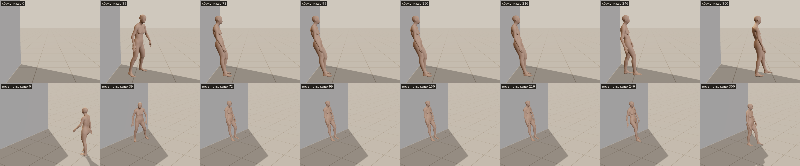
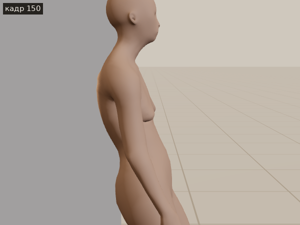
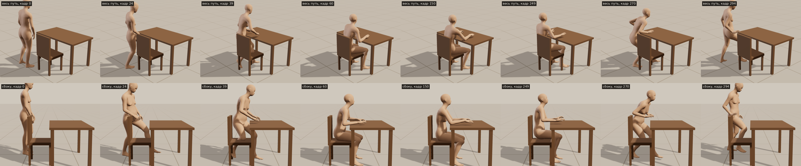
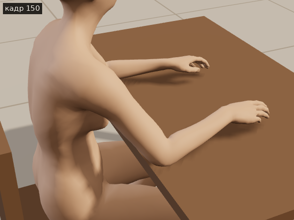
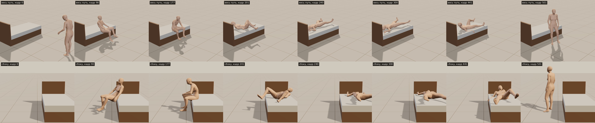
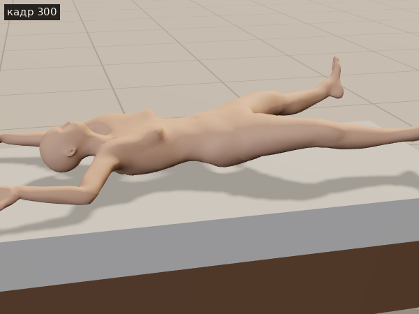

# К2 — Касания телом: стена, лестница, кровать, стол

**Вердикт.** Принцип К1 работает и для тела: место пишется в нашей сцене, переводится в пространство Kimodo и
отдаётся ему как его же ограничение — только теперь не ладонь, а вся поза (спина у стены, тело на кровати), ступни на
ступенях, таз со ступнями (сесть на край кровати), таз с руками (предплечья на столе) и рука в десяти кадрах (рука
скользит по перилам). Все четыре сцены сделаны от начала до конца; Kimodo сам делает подход, поворот, наклон назад,
подъём по ступеням, разворот на кровати и вставание. Поправка сверху нужна только на лестнице (ступни на ступенях,
ладонь на перилах). Слабое: тело на нашем персонаже проседает в мягкое (край кровати 8–9 см, стул 2,5 см), пальцы
руки входят в перила (хвата нет), носки ног иногда заходят в подступенок, на кровати Kimodo лежит «звёздочкой».
Пятый пункт (перешагнуть, сесть на пол у стены) не пробовали.

Страница: `experiments/body-contacts/index.html` (из корня репозитория). Как сделано и цифры — `notes.md`.

Лестница: десять ступеней по 14 см; ступни поставлены Kimodo на наши ступени в середине каждого шага, рука — на
перила каждые полсекунды; наверху обе ноги на площадке.

Рука на перилах: Kimodo держит ладонь в 3–6 см от перил, поправка кладёт её на перила; пальцы обхватывают перила
и уходят в них на 2 см — хвата нет.

Спиной к стене: вся поза Kimodo «прислонился спиной», поставленная так, что спина касается нашей стены; спина в
0–0,6 см от стены всё время, пока стоит, в стену не входит.

Спина у стены близко: касаются лопатки (так Kimodo прислоняется сам), ягодицы в 9 см от стены.

За столом: стул 42 см, стол 72 см; предплечья в 0–1,5 см над столешницей, потом встаёт и отходит.

Предплечья на столе близко.

Кровать: садится на край (проседает в матрас), ложится вдоль на спину — руки над головой, ноги врозь, как Kimodo
лёг сам на полу, — потом садится, спускает ноги и встаёт.

Лежит на кровати: спина и голова на матрасе.

Фильмы: `pics/stairs-side.mp4`, `pics/stairs-front.mp4`, `pics/wall-side.mp4`, `pics/wall-whole.mp4`,
`pics/desk-whole.mp4`, `pics/desk-side.mp4`, `pics/bed-whole.mp4`, `pics/bed-side.mp4`.
